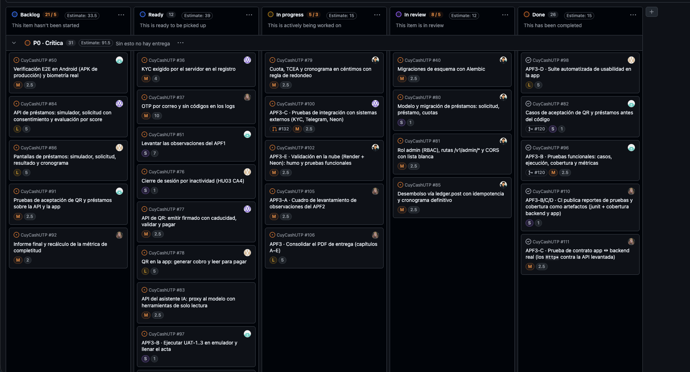
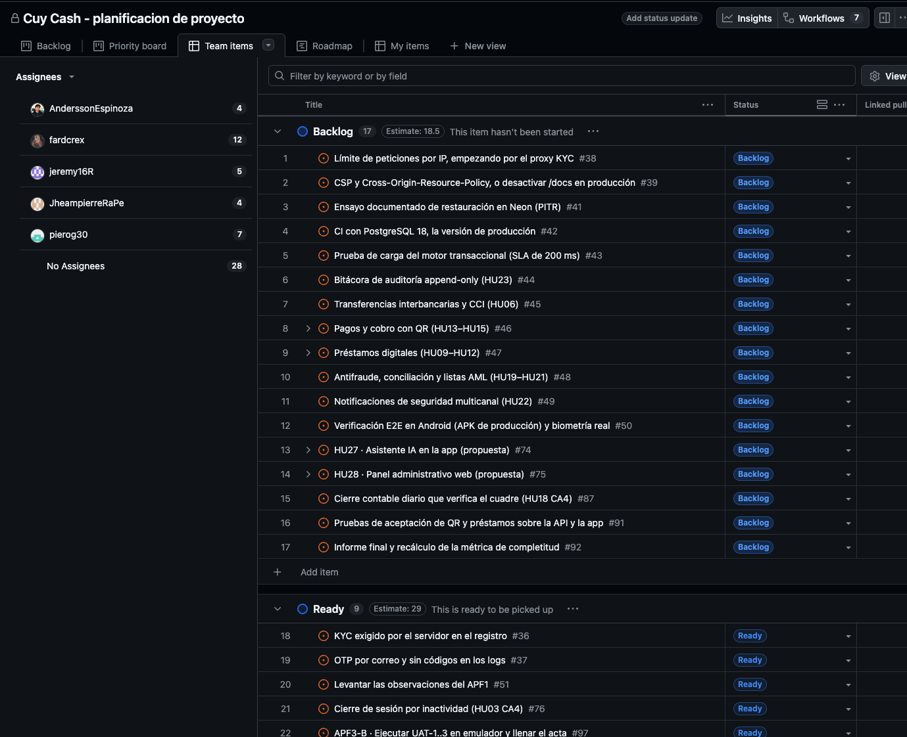

# A. Levantamiento de observaciones del APF2

**Observación recibida en la sustentación:** usar bien la metodología de trabajo
con GitHub Projects, asignando a cada integrante sus tareas y su prioridad por niveles.

La observación se desglosó en cuatro requisitos verificables.

| # | Requisito | Antes | Acción | Evidencia al 04/11/2026 | Estado |
|---|---|---|---|---|---|
| 1 | Cada tarea con responsable | 35 de 35 ítems sin *Assignee* | Un dueño por ítem; tarjetas APF3 #96–#113 con dueño | 42 de 72 ítems asignados; 34 de los 46 abiertos. Sin dueño: 8 épicas/propuestas y #2, #83, #90, #104 | 🟡 En cierre |
| 2 | Prioridad por niveles | Campo *Priority* sin opciones | Campo **Nivel de prioridad** (P0 Crítica / P1 Alta / P2 Media) y número único de orden | 45 ítems comprometidos con nivel: 31 P0, 9 P1, 5 P2 | ✅ Cerrado |
| 3 | Todos avanzan | 294 de 294 commits de una cuenta | Spec por integrante; límite de 2 en curso; PR de cada integrante a `main` | 5 de 6 integrantes con PR fusionado (tabla de autoría) | 🟡 En cierre |
| 4 | Estado, tamaño, estimación, sprint | Campos vacíos | *Size*, estado y *Sprint* en las tarjetas comprometidas; Sprints 5 y 6 | 72 ítems con estado; 49 con *Size*; 39 con *Sprint* (12 en Sprint 5, 27 en Sprint 6) | 🟡 En cierre |

## Estado del tablero (`gh project item-list`, 04/11/2026)

| Estado | Ítems |
|---|---:|
| Done | 26 |
| In review | 8 |
| In progress | 5 |
| Ready | 12 |
| Backlog | 21 |
| **Total** | **72** |

| Responsable | Ítems asignados |
|---|---:|
| Jair Conislla | 13 |
| Andersson Espinoza | 9 |
| Jeremy | 7 |
| Gian Piero Gonzales | 7 |
| Jheampierre | 6 |

Vista *Priority board*, agrupada por **Nivel de prioridad** (carril P0 · Crítica, 31 ítems):

Vista *Team items* de GitHub Projects, agrupada por responsable y con su filtro propio:

## Autoría (corte 04/11/2026, `gh pr list` y `git shortlog`)

| Integrante | PR fusionados desde el 30/10 | Commits desde el 30/10 |
|---|---:|---:|
| Jair Conislla | 14 | 41 |
| Andersson Espinoza | 4 | 12 |
| Jheampierre | 3 | 4 |
| Gian Piero Gonzales | 1 | 2 |
| Jeremy | 1 (y #132 en revisión) | 2 |
| Jair Abdel Linares | 0 | 0 |

Al inicio, una sola cuenta tenía el 100 % de los commits y PR. Desde el 30/10,
esa cuenta concentra 14 de 23 PR (61 %): el reparto mejoró, pero la meta del equipo
(≤ 40 %) aún no se alcanza. La revisión por otra persona quedó registrada
en los PR #95 y #126; extenderla a todos los PR es parte del plan de cierre.

**Nivel de levantamiento al corte:** 1 de 4 requisitos cerrado y 3 en cierre, con
acciones y responsables en el «Plan de cierre» (Anexos).

Comandos para recalcular esta evidencia: `docs/apf3/capitulo-a-observaciones.md`.
