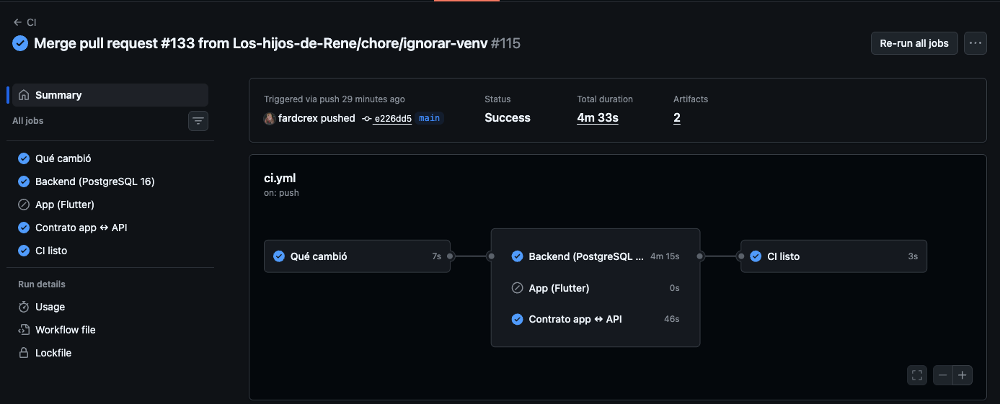
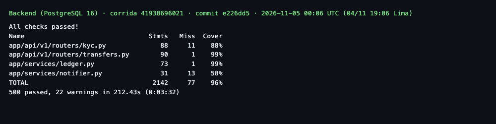
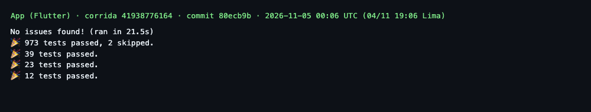
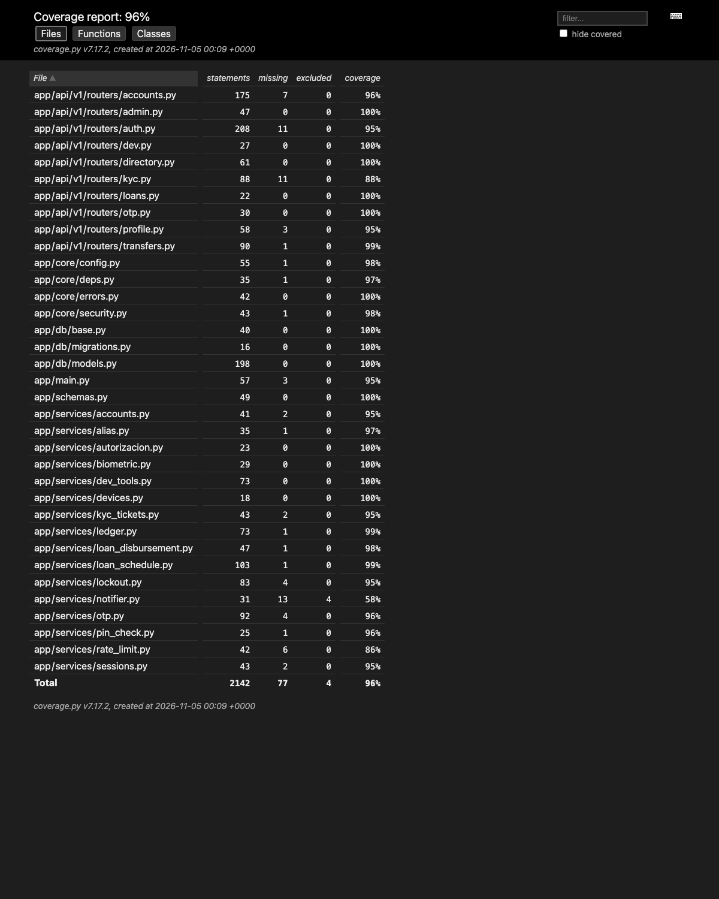

# B. Pruebas funcionales automatizadas

**Responsable:** Gian Piero Gonzales · **Tarjetas:** #96 y #97 · **Corte:**
04/11/2026 · **Commits probados en CI:** `e226dd5` (backend) y `80ecb9b` (app).

El objetivo es verificar completitud, corrección e idoneidad funcional con
criterios trazables. Se distingue entre una prueba que termina en verde y un
criterio de aceptación realmente cumplido: ejecutar líneas no demuestra por sí
solo que el producto entregue toda la función solicitada.

## B.1 Frameworks utilizados y justificación

| Capa | Framework | Justificación técnica |
|---|---|---|
| API | `pytest 8.3.3`, `pytest-asyncio` y `httpx` | Permiten probar servicios asíncronos y contratos HTTP completos, incluyendo código, cuerpo y efectos en base. Los fixtures aíslan cada caso y hacen repetible la preparación de titulares, cuentas y sesiones. |
| Persistencia | SQLAlchemy asíncrono con SQLite local y PostgreSQL en CI (16 en las corridas citadas; 18 desde el PR #135) | SQLite da realimentación rápida; PostgreSQL 18 valida restricciones, bloqueo de filas y concurrencia con el mismo motor previsto para producción. Una prueba local verde no sustituye el job PostgreSQL. |
| App | `flutter_test` y `bloc_test` | `flutter_test` valida widgets, navegación y accesibilidad; `bloc_test` comprueba estados, transiciones y errores sin depender del renderizado. Los contratos de repositorio comparan implementaciones `Memory*` y `Http*`. |
| Cobertura | `pytest-cov`/`coverage.py` y `flutter test --coverage` | Miden líneas ejecutadas y detectan módulos sin ejercicio. La cobertura se interpreta junto con aserciones y RTM; no equivale a ausencia de defectos. |
| Evidencia | JUnit XML y Cobertura XML | Son formatos reproducibles y consumibles por CI. Conservan caso, duración, estado y cobertura sin transcribir resultados manualmente. |

## B.2 Listado trazable de 20 criterios

La selección cubre las cinco HU operativas principales de identidad, consulta,
transferencias y contabilidad. El resultado de la última columna es el
**veredicto del CA**, no solo el color del test. `🟡` indica que la parte citada
pasó, pero queda una condición funcional sin implementar o medir.

| ID | Requisito / criterio | Precondición | Pasos | Resultado esperado | Archivo y nombre exacto de la prueba | Resultado | Evidencia |
|---|---|---|---|---|---|---|---|
| HU03-CA1 | Ingreso facial <1.5 s | Usuario registrado | Intentar autenticación facial y medir | Sesión en menos de 1.5 s | No existe prueba ni login facial | ❌ | RTM §3 |
| HU03-CA2 | Huella o PIN alternativo | Biometría vinculada | Autenticar con credencial válida | Sesión segura creada | `test_biometria.py::test_activar_y_entrar_con_huella` | ✅ | `pytest.xml` |
| HU03-CA3 | Bloqueo tras fallos y aviso | DNI registrado | Fallar el PIN repetidamente | Bloqueo y notificación | `test_registro_y_login.py::test_tres_fallos_bloquean_el_dni_y_ni_el_pin_correcto_entra` | 🟡 | Bloquea al 3.er intento; falta aviso |
| HU03-CA4 | Cierre por inactividad | Sesión abierta | Superar tiempo inactivo | La app vuelve al acceso rápido y pide PIN o huella | `inactivity_watcher_test.dart::sin uso, avisa al agotarse el tiempo y una sola vez` | ✅ | `flutter-tests.json` |
| HU05-CA1 | Cuentas propias, tipo, número enmascarado y saldo | Dos titulares | Consultar `/v1/accounts` | Solo cuentas propias con datos permitidos | `test_cuentas_y_movimientos.py::test_solo_devuelve_las_cuentas_propias` | ✅ | `pytest.xml` |
| HU05-CA2 | Saldo contable y disponible con retenciones | Cuenta con fondos retenidos | Consultar saldos | Ambos saldos reflejan la retención | No existe modelo de retenciones | 🟡 | API entrega ambos campos, hoy iguales |
| HU05-CA3 | Movimientos de la cuenta seleccionada | Varias cuentas con operaciones | Consultar historial por cuenta | No mezcla movimientos | `test_cuentas_y_movimientos.py::test_el_historial_no_mezcla_movimientos_de_otras_cuentas` | ✅ | `pytest.xml` |
| HU05-CA4 | Exportación PDF/Excel | Historial disponible | Solicitar exportación | Archivo descargable coherente | No existe exportación | ❌ | RTM §3 |
| HU06-CA1 | Transferencia propia inmediata y sin costo | Dos cuentas PEN del titular | Enviar S/10.00 | Débito y crédito exactos | `test_envio_por_cuenta.py::test_entre_cuentas_propias_se_puede` | ✅ | `pytest.xml` |
| HU06-CA2 | Interbancaria CCI/CCE | CCI válido y red disponible | Confirmar envío | Titular validado y orden emitida | No existe conector interbancario | ❌ | RTM §3 |
| HU06-CA3 | Rechazo sin fondos sin afectar saldos | Saldo menor al monto | Intentar enviar | `INSUFFICIENT_FUNDS`, cero asientos | `test_transferencias.py::test_sin_saldo_suficiente_responde_insufficient_funds` | ✅ | `pytest.xml` |
| HU06-CA4 | Comprobante completo | Transferencia confirmada | Consultar/compartir constancia | Fecha, monto, cuentas y operación | `receipt_card_test.dart::muestra monto, contraparte, motivo, estado, fecha y operación` | ✅ | `flutter-tests.json` |
| HU17-CA1 | Validar saldo antes de ejecutar | Cuenta con saldo insuficiente | Publicar débito | No se escribe nada | `test_motor_de_asientos.py::test_sin_saldo_no_escribe_nada` | ✅ | `pytest.xml` |
| HU17-CA2 | Bloquear fondos hasta confirmar | Cuenta leída por dos operaciones | Bloquear y releer | Se usa el saldo actual bajo bloqueo | `test_motor_de_asientos.py::test_una_cuenta_ya_cargada_se_relee_tras_el_bloqueo` | 🟡 | Hay bloqueo de fila; no retención separada |
| HU17-CA3 | Idempotencia | Transferencia ya confirmada | Repetir la misma clave | Devuelve la original sin nuevo cargo | `test_motor_de_asientos.py::test_repetir_la_clave_devuelve_la_original_sin_cobrar_de_nuevo` | ✅ | `pytest.xml` |
| HU17-CA4 | Procesamiento <200 ms | Entorno de carga controlado | Medir transacción p95/p99 | Duración menor a 200 ms | No existe prueba de rendimiento | ❌ | No medido |
| HU18-CA1 | Débito = crédito | Operación autorizada | Contabilizar transferencia | Sumas iguales por transacción | `test_libro_mayor.py::test_una_transferencia_deja_los_debitos_iguales_a_los_creditos` | ✅ | `pytest.xml` |
| HU18-CA2 | UUID por asiento | Transacción con dos asientos | Persistir y consultar IDs | IDs propios, válidos y distintos | `test_motor_de_asientos.py::test_cada_asiento_y_su_transaccion_llevan_un_uuid_propio` | ✅ | `pytest.xml` |
| HU18-CA3 | Atomicidad, sin asiento parcial | Entrada inválida o saldo insuficiente | Intentar publicar | Rollback completo | `test_motor_de_asientos.py::test_entradas_invalidas_revientan_antes_de_tocar_la_base` | ✅ | `pytest.xml` |
| HU18-CA4 | Cierre contable diario | Día de negocio cerrado | Ejecutar conciliación | Diferencias detectadas y auditadas | No existe proceso de cierre | ❌ | RTM §3 |

### Corrección numérica obligatoria

| Caso | Control verificado | Resultado 02/11/2026 |
|---|---|---|
| Dinero sin `double` | Montos HTTP y persistencia son enteros de céntimos; más de dos decimales se rechazan | ✅ `test_un_monto_que_no_es_entero_de_centimos_no_mueve_dinero` |
| Envío de S/125.50 | UAT-1 usa `12550` céntimos y verifica ambos saldos | ✅ `test_uat1_enviar_dinero_a_otro_titular_y_que_ambos_lados_cuadren` |
| Partida doble | Total débito = total crédito por ID de transacción | ✅ `test_una_transferencia_deja_los_debitos_iguales_a_los_creditos` |

## B.3 Capturas de ejecución

Salida del CI de GitHub Actions en `main`, tomada del log de cada job. Estos
reportes se publican como artefactos de cada corrida.







Comandos equivalentes en local:

```sh
cd services/api && .venv/bin/python -m pytest -q --cov=app --junitxml=pytest.xml
cd apps/mobile && flutter analyze && flutter test --coverage
```

La primera corrida en Windows (02/11, `44a9c36`) detectó tres incompatibilidades
portables: codificación de `schema.sql`, salida del generador DDL y uso
incondicional de `time.tzset`. Se fijó UTF-8 explícito y el caso POSIX pasó a
omisión declarada. Evidencia de esa corrida en `docs/apf3/evidencias/gian-piero/`.

## B.4 Reportes de cobertura

| Componente | Líneas | Cubiertas | Cobertura | Lectura |
|---|---:|---:|---:|---|
| Backend total | 2,142 | 2,065 | **96.41 %** | Medido en CI con PostgreSQL 16 |
| `services/ledger.py` | | | 98.63 % | Crítico: libro mayor |
| `routers/transfers.py` | | | 98.89 % | Crítico: envíos |
| `routers/loans.py` | | | 100 % | Rutas de préstamos |
| `db/base.py` | | | 100 % | Conexión y pool |
| `routers/kyc.py` | | | 87.50 % | 92.55 % con el PR #132, ya en `main` |
| `services/notifier.py` | | | 58.06 % | 97.30 % con el PR #132, ya en `main` |
| App Flutter | 9,214 | 7,044 | **76.45 %** | LCOV del job App (Flutter) |



Reportes: `docs/apf3/evidencias/jair-conislla/ci-cobertura-backend.xml` y
`ci-cobertura-app.lcov`.

## B.5 Métricas ISO/IEC 25023 y cumplimiento

| Métrica | Fórmula | Resultado al 04/11/2026 | Interpretación |
|---|---|---:|---|
| Casos backend | aprobados / fallidos / omitidos | 500 / 0 / 0 | PostgreSQL 16 real |
| Casos app | aprobados / fallidos / omitidos | 973 / 0 / 2 | 975 recolectados |
| Paquetes compartidos | aprobados / fallidos | 35 / 0 | 23 `core_kernel` + 12 `design_system` |
| Cumplimiento de ejecución | aprobados ÷ recolectados | **99.87 %** (1508/1510) | Supera la meta de 90 % |
| Corrección ejecutada `Y` | verdes ÷ ejecutados | **100 %** (1508/1508) | Ningún fallo entre los casos ejecutados |
| Completitud funcional `X` | CA con prueba ÷ CA del MVP | **13.5 %** (13/96) | Fuente: RTM, `docs/idoneidad-funcional.md` §5 |
| Criterios de esta muestra | CA cumplidos ÷ CA listados | **60 %** (12/20) | 3 parciales y 5 sin implementar o medir |
| Cobertura backend | sentencias ejecutadas ÷ sentencias | **96.41 %** | No implica ausencia de defectos |
| Cobertura app | líneas cubiertas ÷ líneas | **76.45 %** | Reporte LCOV |

### Observaciones y limitaciones

1. La corrección es alta, pero la completitud es baja: el 13.5 % refleja que el
   MVP completo son 96 CA y el núcleo construido es identidad, cuentas y libro mayor.
2. La suite Flutter sustituye sensores con dobles controlados; no demuestra
   cámara, huella ni rendimiento en un teléfono Android.
3. El SLA transaccional de 200 ms y el ingreso de 1.5 s no se midieron con una
   herramienta de carga; permanecen como CA no cumplidos.
4. QR (#125) y préstamos (`routers/loans.py`) ya tienen código y pruebas, pero la
   RTM aún no los acredita como CA cumplidos.
5. Un 96 % de cobertura solo indica líneas recorridas. La calidad depende de los
   oráculos, los límites, los datos negativos y la revisión de código.

## B.6 UAT y acta de validación (#97)

Los escenarios UAT-1..3 automatizados (`services/api/tests/test_aceptacion_uat.py`)
están verdes en CI. El recorrido en emulador con acta firmada (`docs/vyv.md` §5) no
se ha realizado y está en el plan de cierre (Anexos). Una prueba HTTP automatizada
no se presenta como aceptación de usuario en emulador.
