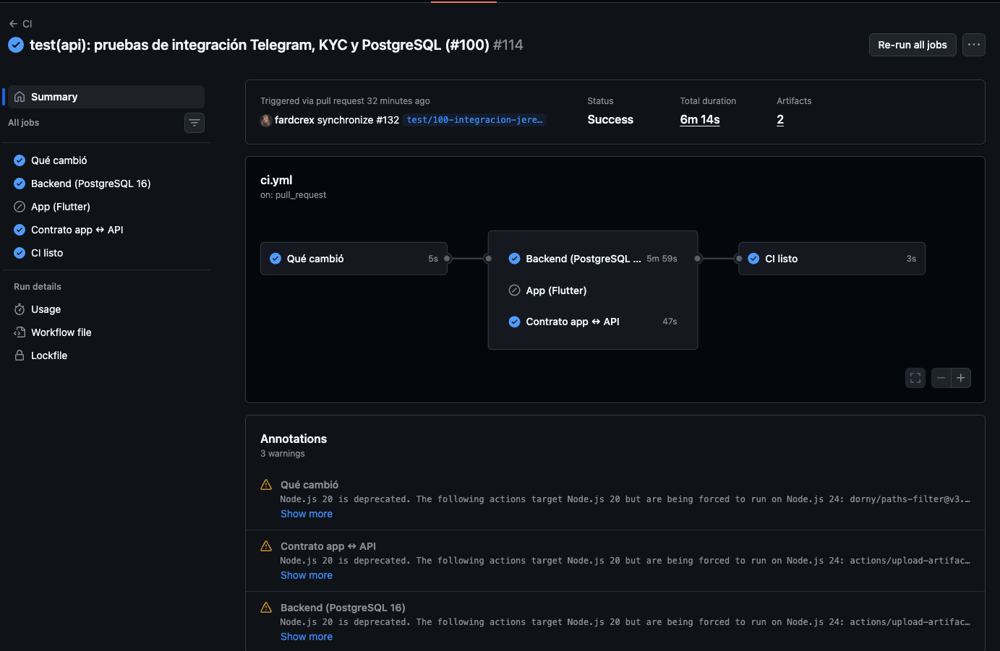
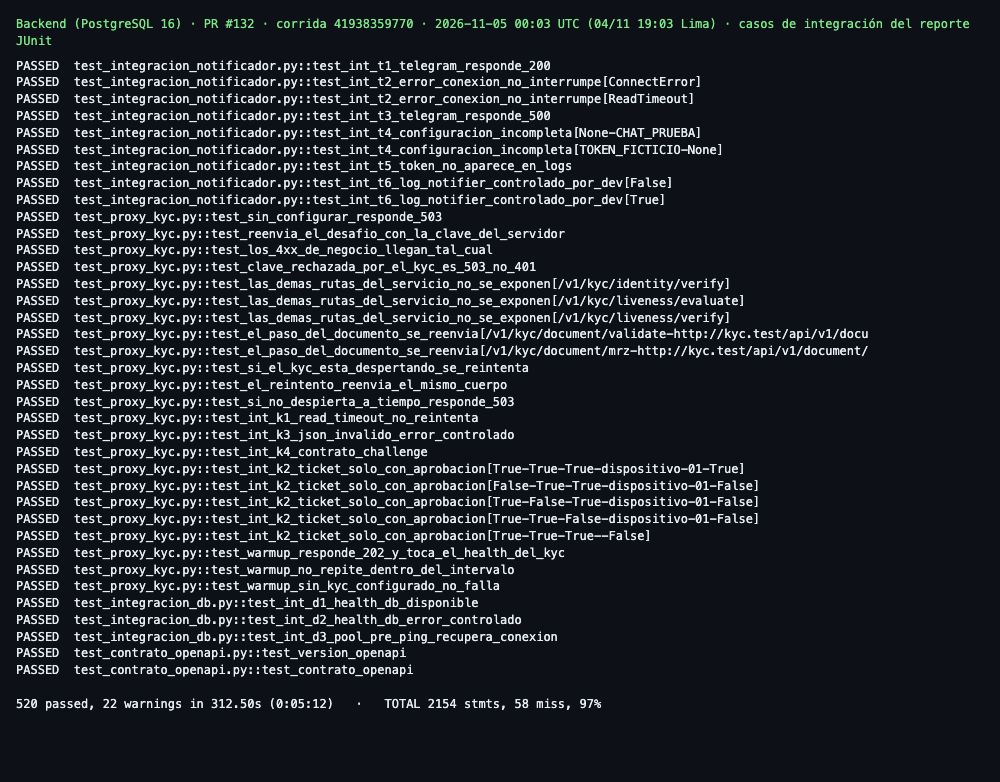
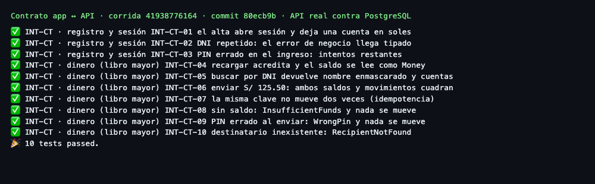
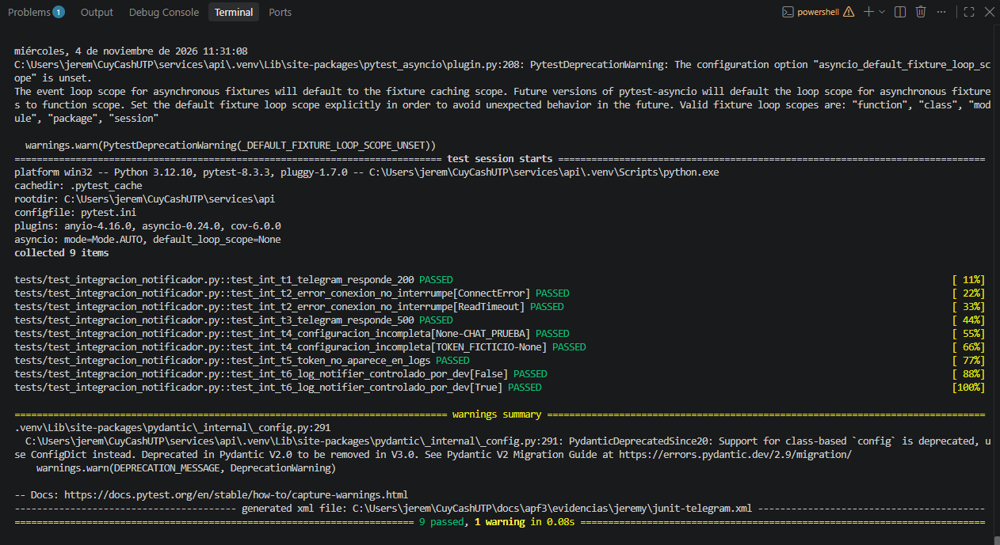

# C. Pruebas de integración automatizadas

**Responsables:** Jeremy (#100, #101) · Andersson (#103) · Jair Conislla (#111) · **Corte:** 04/11/2026.

## C.1 Sistemas externos a integrar
| Sistema | Cómo se integra | Riesgo de interoperabilidad | Mitigación |
|---|---|---|---|
| Microservicio KYC (`CuyCashKYC`) | Proxy de `services/api` (`/v1/kyc/*`); la clave vive en el backend | Se duerme en plan gratuito; cambio de contrato; red | Reintento solo si la petición no llegó (502/503/504); clave rechazada → 503; lista blanca de rutas |
| PostgreSQL (Neon) | `asyncpg` + SQLAlchemy | Neon suspende el cómputo y cierra conexiones | `pool_pre_ping=True` |
| Render (hosting) | Docker, `$PORT`, `/health` | Arranque en frío | Despliegue solo por Actions; health check; rollback |
| Telegram (OTP de demostración) | `httpx`, timeout 10 s | Cae el servicio | Un fallo no tumba el flujo; reenvío |
| ML Kit / `local_auth` | Plugins de Flutter | Cambian con el sistema operativo | Detrás de interfaces con doble `Memory*` |
| GitHub Actions | Workflows | Cambio de versión de una acción | Acciones fijadas por versión mayor |

Fuente: `docs/compatibilidad-y-coexistencia.md` §1.

## C.2 Frameworks para la integración y las pruebas

| Framework | Uso | Justificación |
|---|---|---|
| `pytest` + `pytest-asyncio` | Casos HTTP de la API | Mismo ejecutor de la suite funcional; fixtures aislados |
| `httpx.MockTransport` | Simula Telegram y el KYC | Determinista, sin red y sin gastar el KYC de plan gratuito; permite provocar timeouts y JSON inválido |
| PostgreSQL en CI (16 en las corridas citadas; 18 desde el PR #135) | Base real para reconexión y concurrencia | SQLite no reproduce el bloqueo de fila ni `pool_pre_ping` |
| `flutter test` (`contract_test/`) | Repositorios `Http*` de la app contra la API levantada | Valida el contrato real app ↔ backend |
| `openapi.json` versionado | Contrato de la API | Un cambio de contrato hace fallar la prueba |

## C.3 Casos de prueba de interoperabilidad

**Backend (37 casos, reporte JUnit del PR #132):**

| ID | Sistema | Prueba | Resultado |
|---|---|---|---|
| INT-01 | Telegram | `test_int_t1_telegram_responde_200` | ✅ |
| INT-02 | Telegram | `test_int_t2_error_conexion_no_interrumpe[ConnectError]` | ✅ |
| INT-03 | Telegram | `test_int_t2_error_conexion_no_interrumpe[ReadTimeout]` | ✅ |
| INT-04 | Telegram | `test_int_t3_telegram_responde_500` | ✅ |
| INT-05 | Telegram | `test_int_t4_configuracion_incompleta[None-CHAT_PRUEBA]` | ✅ |
| INT-06 | Telegram | `test_int_t4_configuracion_incompleta[TOKEN_FICTICIO-None]` | ✅ |
| INT-07 | Telegram | `test_int_t5_token_no_aparece_en_logs` | ✅ |
| INT-08 | Telegram | `test_int_t6_log_notifier_controlado_por_dev[False]` | ✅ |
| INT-09 | Telegram | `test_int_t6_log_notifier_controlado_por_dev[True]` | ✅ |
| INT-10 | KYC | `test_sin_configurar_responde_503` | ✅ |
| INT-11 | KYC | `test_reenvia_el_desafio_con_la_clave_del_servidor` | ✅ |
| INT-12 | KYC | `test_los_4xx_de_negocio_llegan_tal_cual` | ✅ |
| INT-13 | KYC | `test_clave_rechazada_por_el_kyc_es_503_no_401` | ✅ |
| INT-14 | KYC | `test_las_demas_rutas_del_servicio_no_se_exponen[/v1/kyc/identity/verify]` | ✅ |
| INT-15 | KYC | `test_las_demas_rutas_del_servicio_no_se_exponen[/v1/kyc/liveness/evaluate]` | ✅ |
| INT-16 | KYC | `test_las_demas_rutas_del_servicio_no_se_exponen[/v1/kyc/liveness/verify]` | ✅ |
| INT-17 | KYC | `test_el_paso_del_documento_se_reenvia[/v1/kyc/document/validate-http://kyc.test/api/v1/document/validate]` | ✅ |
| INT-18 | KYC | `test_el_paso_del_documento_se_reenvia[/v1/kyc/document/mrz-http://kyc.test/api/v1/document/mrz]` | ✅ |
| INT-19 | KYC | `test_si_el_kyc_esta_despertando_se_reintenta` | ✅ |
| INT-20 | KYC | `test_el_reintento_reenvia_el_mismo_cuerpo` | ✅ |
| INT-21 | KYC | `test_si_no_despierta_a_tiempo_responde_503` | ✅ |
| INT-22 | KYC | `test_int_k1_read_timeout_no_reintenta` | ✅ |
| INT-23 | KYC | `test_int_k3_json_invalido_error_controlado` | ✅ |
| INT-24 | KYC | `test_int_k4_contrato_challenge` | ✅ |
| INT-25 | KYC | `test_int_k2_ticket_solo_con_aprobacion[True-True-True-dispositivo-01-True]` | ✅ |
| INT-26 | KYC | `test_int_k2_ticket_solo_con_aprobacion[False-True-True-dispositivo-01-False]` | ✅ |
| INT-27 | KYC | `test_int_k2_ticket_solo_con_aprobacion[True-False-True-dispositivo-01-False]` | ✅ |
| INT-28 | KYC | `test_int_k2_ticket_solo_con_aprobacion[True-True-False-dispositivo-01-False]` | ✅ |
| INT-29 | KYC | `test_int_k2_ticket_solo_con_aprobacion[True-True-True--False]` | ✅ |
| INT-30 | KYC | `test_warmup_responde_202_y_toca_el_health_del_kyc` | ✅ |
| INT-31 | KYC | `test_warmup_no_repite_dentro_del_intervalo` | ✅ |
| INT-32 | KYC | `test_warmup_sin_kyc_configurado_no_falla` | ✅ |
| INT-33 | PostgreSQL | `test_int_d1_health_db_disponible` | ✅ |
| INT-34 | PostgreSQL | `test_int_d2_health_db_error_controlado` | ✅ |
| INT-35 | PostgreSQL | `test_int_d3_pool_pre_ping_recupera_conexion` | ✅ |
| INT-36 | OpenAPI | `test_version_openapi` | ✅ |
| INT-37 | OpenAPI | `test_contrato_openapi` | ✅ |

**Contrato app ↔ API real (10 casos):**

| ID | Caso | Resultado |
|---|---|---|
| INT-CT-01 | El alta abre sesión y deja una cuenta en soles | ✅ |
| INT-CT-02 | DNI repetido: el error de negocio llega tipado | ✅ |
| INT-CT-03 | PIN errado en el ingreso: intentos restantes | ✅ |
| INT-CT-04 | Recargar acredita y el saldo se lee como `Money` | ✅ |
| INT-CT-05 | Buscar por DNI devuelve nombre enmascarado y cuentas | ✅ |
| INT-CT-06 | Enviar S/ 125.50: ambos saldos y movimientos cuadran | ✅ |
| INT-CT-07 | La misma clave no mueve dos veces (idempotencia) | ✅ |
| INT-CT-08 | Sin saldo: `InsufficientFunds` y nada se mueve | ✅ |
| INT-CT-09 | PIN errado al enviar: `WrongPin` y nada se mueve | ✅ |
| INT-CT-10 | Destinatario inexistente: `RecipientNotFound` | ✅ |

## C.4 Capturas de ejecución

## C.5 Reportes de resultados

| Grupo | Casos | Aprobados | Fallidos | Omitidos | Corrida |
|---|---:|---:|---:|---:|---|
| Telegram | 9 | 9 | 0 | 0 | CI 41938359770 |
| KYC (proxy) | 23 | 23 | 0 | 0 | CI 41938359770 |
| PostgreSQL | 3 | 3 | 0 | 0 | CI 41938359770 |
| Contrato OpenAPI | 2 | 2 | 0 | 0 | CI 41938359770 |
| Contrato app ↔ API | 10 | 10 | 0 | 0 | CI 41938776164 |
| **Total** | **47** | **47** | **0** | **0** | |

Reportes: `docs/apf3/evidencias/jair-conislla/ci-pytest-pr132.xml` y
`ci-contrato.json`. Corrida completa del backend en ese PR: 520 aprobadas, 0
omitidas, cobertura 97.31 %.

## C.6 Métricas, cumplimiento y observaciones

| Métrica | Resultado |
|---|---|
| Cumplimiento | **100 %** (47/47), meta ≥ 90 % |
| Cobertura `services/notifier.py` | 97.30 % |
| Cobertura `routers/kyc.py` | 92.55 % |
| Cobertura `services/kyc_tickets.py` | 95.35 % |
| Cobertura `db/base.py` | 100 % |
| Defectos hallados y corregidos | 2 |

**Defectos hallados por las pruebas:**

1. Una excepción de Telegram podía revelar el token del bot en los registros
   (INT-T5). Se corrigió el manejo de errores.
2. Un JSON malformado del KYC podía llegar al cliente con HTTP 200 (INT-K3). Ahora
   responde un error controlado HTTP 502.

**Observaciones:**

1. Las pruebas de Telegram y KYC usan servicios simulados: detectan regresiones de
   nuestro lado, no un cambio del proveedor ni el arranque en frío real.
2. El PostgreSQL de CI no es Neon: no hay prueba automatizada directa contra Neon.
3. La suite y sus dos correcciones se integraron con el PR #132 (`7e3d3ea`) y ese commit
   corre en producción desde el 05/11.
4. ML Kit y `local_auth` están detrás de dobles; no se probaron en un teléfono.

## C.7 Coexistencia de la API — Andersson #103

Integrado en `main` con el [PR #121](https://github.com/Los-hijos-de-Rene/CuyCashUTP/pull/121).

| Caso | Resultado real en laboratorio |
|---|---|
| COEX-01 Construir imagen y comprobar identidad | Imagen Python3.12 construida; proceso `app`, UID/GID999 |
| COEX-02 Arranque API/PostgreSQL16 | `/health` y `/health/db` HTTP200 |
| COEX-03 Memoria acotada | Límite Docker536870912 bytes (512MiB); medición puntual en recursos.txt, sin certificación de carga máxima |
| COEX-04 Pool configurable y Neon | 4 pruebas: valores de pool/overflow/timeout, rechazo de rangos inválidos y normalización TLS de URL Neon; sin conexión directa a Neon |
| COEX-05 Apagado | `exec uvicorn` como proceso1; `docker stop` termina exit0, OOMKilled=false y registro de cierre completo |
| COEX-06 Regresión | CI del código a529dee:436 pruebas PostgreSQL aprobadas,96% cobertura y10 contratos app/API |

Evidencias en `docs/apf3/evidencias/andersson/coexistencia/` (construcción, identidad,
recursos, apagado) y [corrida de CI](https://github.com/Los-hijos-de-Rene/CuyCashUTP/actions/runs/41757142389).
Procedimiento en `docs/compatibilidad-y-coexistencia.md` §7. Estas pruebas son de
laboratorio con Docker: no acreditan por sí solas el comportamiento en Android ni en producción.
