# D. Evaluación de la usabilidad

**Responsables:** Jheampierre (#98, #99) · Jair Abdel Linares (#104) · **Corte:** 04/11/2026.

## D.1 Informe de evaluación de usabilidad

**Objetivo y alcance.** Evaluar la usabilidad del flujo principal (ingreso, consulta
de saldo y envío de dinero) según ISO/IEC 25010. Alcance: 8 pantallas de la app.

**Método.** Este informe se basa en la suite automatizada y en una revisión de las
heurísticas de Nielsen contra sus resultados. La sesión con 5 usuarios y la encuesta
SUS aún no se han realizado (ver «Pendiente de este informe»).

**Resultado por característica ISO/IEC 25010:**

| Característica | Qué se verificó | Casos | Resultado |
|---|---|---:|---|
| Accesibilidad | Áreas táctiles ≥ 48 dp, etiquetas, contraste de texto | 8 | ✅ Cumple, tras 3 correcciones |
| Adaptabilidad | Texto al 200 % sin desbordes | 8 | ✅ Cumple, tras 3 correcciones |
| Operabilidad | Teléfono de 320×568 sin desbordes | 7 | ✅ Cumple |
| Protección contra errores | Acción bloqueada hasta datos válidos; dinero solo con PIN | Monto, Confirmar | ✅ Cumple |
| Recuperación | El error dice qué hacer, sin códigos técnicos | Registro, Inicio y otras | ✅ Cumple |
| Retroalimentación | Silueta visible durante la carga | Inicio y otras | ✅ Cumple |

**Revisión heurística (Nielsen), con la evidencia disponible:**

| Heurística | Evidencia en la app o en la suite | Valoración |
|---|---|---|
| Visibilidad del estado | Silueta de carga (UX-INICIO-04) | Favorable |
| Relación con el mundo real | Copy es-PE; montos en soles | Favorable |
| Control y libertad | Botón «Volver» etiquetado; PIN antes de mover dinero | Favorable |
| Consistencia | Tokens únicos de `design_system` | Favorable |
| Prevención de errores | Acción deshabilitada; nombre enmascarado; misma moneda | Favorable |
| Reconocer antes que recordar | Búsqueda por DNI o alias; lista de cuentas del destinatario | Favorable |
| Flexibilidad y eficiencia | Acceso rápido con PIN o huella | Por validar con usuarios |
| Diseño minimalista | Revisión de capturas, sin medición | Por validar con usuarios |
| Ayuda ante errores | Mensajes sin códigos técnicos (UX-INICIO-05, UX-REG-04) | Favorable |
| Ayuda y documentación | Sin ayuda en la app | Oportunidad de mejora |

**Hallazgos priorizados (corregidos):** ver la tabla de D.6.

**Limitaciones.** La suite mide reglas objetivas, no aprendizaje ni satisfacción
humana. La revisión heurística es del equipo, no de evaluadores externos.

**Pendiente de este informe.** Sesión con 5 usuarios: tarea «enviar S/ 10», tasa de
éxito (meta ≥ 80 %), tiempos, errores y SUS (meta ≥ 68). Aún no hay datos, y no se
reporta ninguna cifra de usuarios. Programada antes de la sustentación (Anexos).

## D.2 Frameworks

| Framework | Uso |
|---|---|
| `flutter_test` | Pruebas de widgets en CI, sin emulador y deterministas |
| *Guidelines* de accesibilidad | `androidTapTargetGuideline`, `labeledTapTargetGuideline`, `textContrastGuideline` |
| `bloc_test` y dobles `Memory*` | Estados de carga y error sin red |
| `test/usabilidad/_harness.dart` | Tamaño de pantalla, escala de texto, tema y localización es-PE |

Límite: no sustituye a una prueba con personas ni a un E2E en un dispositivo real.

## D.3 Casos de prueba de interfaz y usabilidad

| Código | Pantalla | Descripción | Resultado |
|---|---|---|---|
| UX-01 | Login | Áreas táctiles ≥ 48 dp (`androidTapTargetGuideline`) | ✅ |
| UX-02 | Login | Todo control tocable tiene etiqueta (`labeledTapTargetGuideline`) | ✅ |
| UX-03 | Login | Contraste de texto suficiente (`textContrastGuideline`) | ✅ |
| UX-04 | Login | Texto al 200 % sin desbordes | ✅ |
| UX-REG-01 | Registro | Áreas táctiles ≥ 48 dp, etiquetas y contraste | ✅ |
| UX-REG-02 | Registro | Texto al 200 % sin desbordes (4 campos visibles) | ✅ |
| UX-REG-03 | Registro | Teléfono 320×568 sin desbordes | ✅ |
| UX-REG-04 | Registro | Avanzar con datos inválidos explica qué corregir, sin códigos técnicos | ✅ |
| UX-REG-05 | Registro | El botón «Continuar» queda al alcance tras el scroll | ✅ |
| UX-INICIO-01 | Inicio | Áreas táctiles, etiquetas y contraste | ✅ |
| UX-INICIO-02 | Inicio | Texto al 200 % sin desbordes; el saldo sigue visible | ✅ |
| UX-INICIO-03 | Inicio | Teléfono 320×568 sin desbordes | ✅ |
| UX-INICIO-04 | Inicio | Mientras carga se ve la silueta (`HomeSkeleton`), no un vacío ni spinner | ✅ |
| UX-INICIO-05 | Inicio | El error de red dice qué hacer y no filtra códigos técnicos | ✅ |
| UX-DEST-01 | Destinatario | Áreas táctiles, etiquetas y contraste | ✅ |
| UX-DEST-02 | Destinatario | Texto al 200 % sin desbordes | ✅ |
| UX-DEST-03 | Destinatario | Teléfono 320×568 sin desbordes | ✅ |
| UX-DEST-04 | Destinatario | «Buscar» solo aparece con un alias válido | ✅ |
| UX-DEST-05 | Destinatario | Un DNI desconocido explica qué pasó y qué hacer | ✅ |
| UX-MONTO-01 | Monto | Áreas táctiles, etiquetas y contraste | ✅ |
| UX-MONTO-02 | Monto | Texto al 200 % sin desbordes | ✅ |
| UX-MONTO-03 | Monto | Teléfono 320×568 sin desbordes | ✅ |
| UX-MONTO-04 | Monto | «Continuar» deshabilitado hasta que el monto es válido | ✅ |
| UX-MONTO-05 | Monto | Un monto fuera del límite indica el máximo y bloquea el avance | ✅ |
| UX-CONF-01 | Confirmar | Áreas táctiles, etiquetas y contraste | ✅ |
| UX-CONF-02 | Confirmar | Texto al 200 % sin desbordes | ✅ |
| UX-CONF-03 | Confirmar | Teléfono 320×568 sin desbordes | ✅ |
| UX-CONF-04 | Confirmar | No se puede confirmar hasta tener los 6 dígitos | ✅ |
| UX-CONF-05 | Confirmar | El dinero no se mueve sin el PIN completo (1 llamada, PIN correcto) | ✅ |
| UX-MOV-01 | Movimientos | Áreas táctiles, etiquetas y contraste | ✅ |
| UX-MOV-02 | Movimientos | Texto al 200 % sin desbordes; el título sigue visible | ✅ |
| UX-MOV-03 | Movimientos | Teléfono 320×568 sin desbordes | ✅ |
| UX-MOV-04 | Movimientos | Mientras carga se ve la silueta (`MovementsSkeleton`) | ✅ |
| UX-MOV-05 | Movimientos | El historial de una cuenta muestra su saldo | ✅ |
| UX-PERFIL-01 | Perfil | Áreas táctiles, etiquetas y contraste | ✅ |
| UX-PERFIL-02 | Perfil | Texto al 200 % sin desbordes; el DNI sigue visible | ✅ |
| UX-PERFIL-03 | Perfil | Teléfono 320×568 sin desbordes | ✅ |
| UX-PERFIL-04 | Perfil | Cerrar sesión pide confirmación antes de actuar | ✅ |
| UX-PERFIL-05 | Perfil | El perfil muestra el alias y permite editarlo | ✅ |

## D.4 Capturas de ejecución

Capturas de la corrida del 03/11/2026 a 390×844 y a 320×568 (16 en total, en
`docs/apf3/evidencias/jheampierre/capturas/`):

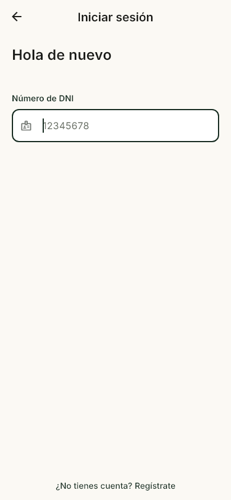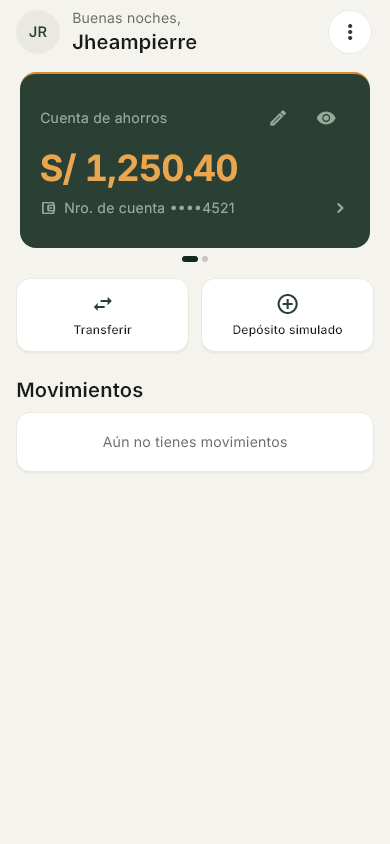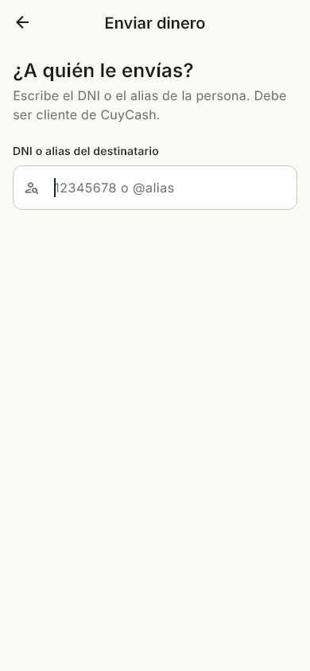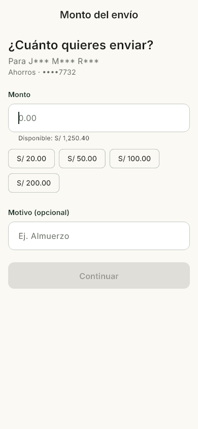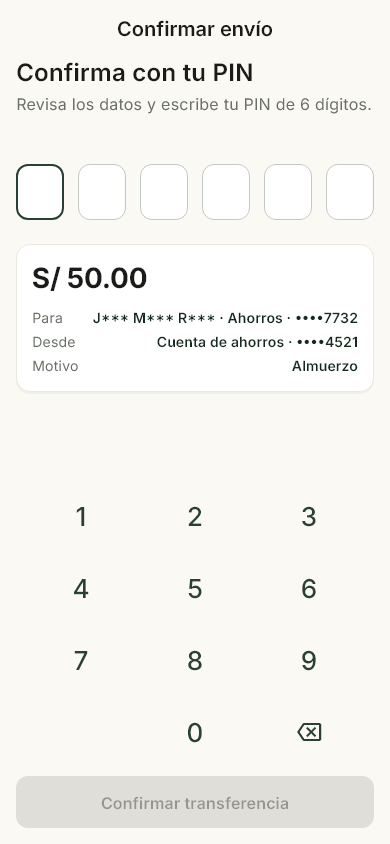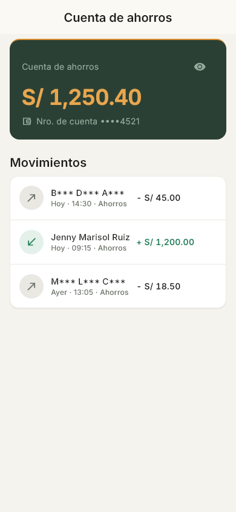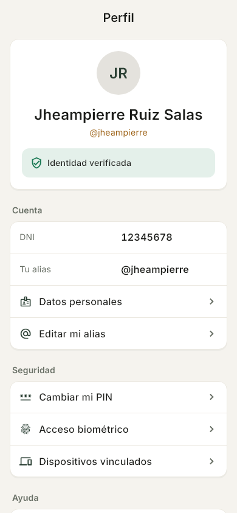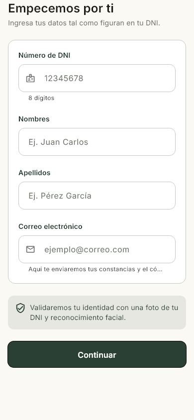

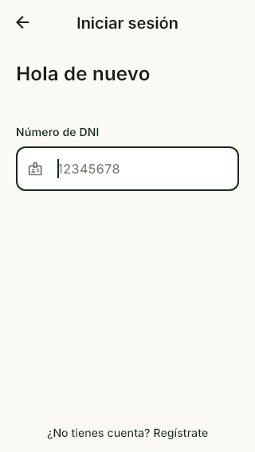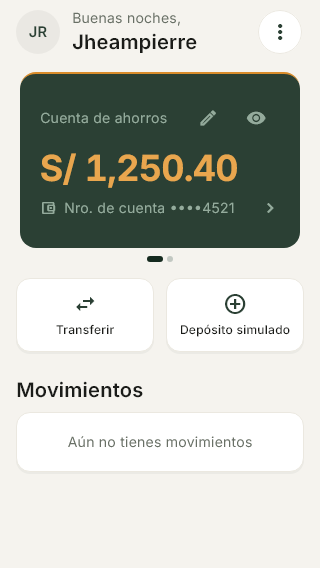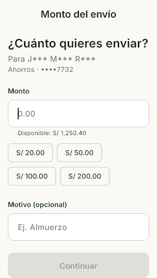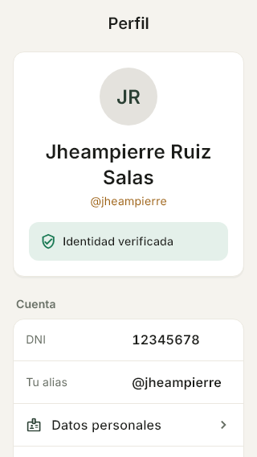

## D.5 Reportes de resultados

| Corrida | Entorno | Aprobados | Fallidos | Omitidos |
|---|---|---:|---:|---:|
| Local, 03/11/2026 23:24 | Windows, Flutter 3.47.1 | 39 | 0 | 0 |
| CI 41938776164, 04/11/2026 | Ubuntu, Flutter 3.41.7 | 39 | 0 | 0 |

Reportes: `docs/apf3/evidencias/jheampierre/reporte-usabilidad.md`,
`usabilidad-expanded.txt` y `usabilidad.clean.json`.

## D.6 Métricas, cumplimiento y observaciones

| Métrica | Resultado |
|---|---|
| Casos | 39 · 39 aprobados · 0 fallidos · 0 omitidos |
| Cumplimiento | **100 %** (meta ≥ 90 %) |
| Pantallas cubiertas | 8 de 8 del flujo principal |
| Hallazgos corregidos | 6 de 6 |

| Hallazgo | Pantalla | Qué falló | Gravedad | Corrección |
|---|---|---|---|---|
| UX-02 | Login | «Volver» sin etiqueta para lectores de pantalla | Media | `tooltip` con `commonBack` |
| UX-03 | Inicio | Botones de 40×40 dp | Media | Mínimo de 48×48 |
| UX-04 | Inicio / Movimientos | A 200 % el monto desborda 17 px | Media | `Flexible` + `FittedBox` |
| UX-05 | Inicio | El carrusel desborda 0.79 px a 200 % | Baja | El alto escala con el texto |
| UX-06 | Perfil | Contraste de 4.47:1 (< 4.5 WCAG AA) | Media | Color a 4.61:1 |
| UX-07 | Perfil | Fila desborda 69 px a 200 % con alias largo | Media | `Flexible` + `FittedBox` |

**Observaciones:** el contraste se verifica sobre colores renderizados, no en un
teléfono con brillo bajo; la regresión visual con *goldens* aún no está en CI; y
5 usuarios no serán una muestra estadística.
