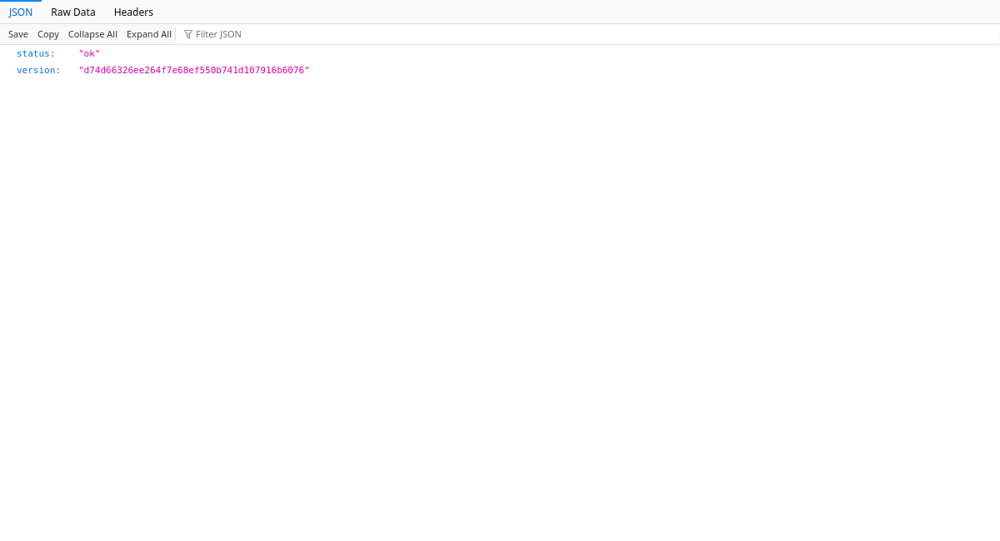

# E. Validación en la plataforma Cloud (Andersson #102)

Ensayo del 2026-11-04 01:36–01:39 UTC (03/11 en Lima). URL:
<https://cuycashutp.onrender.com>. Evidencias reales en
[`../evidencias/andersson/`](../evidencias/andersson/).

## Resultado contra Render + Neon

| Verificación | Esperado | Obtenido |
|---|---|---|
| `/health` | HTTP 200 y commit | 200; `d74d66326ee264f7e68ef550b741d107916b6076` (merge PR #64) |
| `/health/db` | PostgreSQL disponible | 200, `status=ok`; latencia interna 340,9 ms en segunda muestra |
| Humo existente | 0 fallos | 0 fallos; `smoke-production.txt` |
| HTTP → HTTPS | 301 | 301 |
| Sesión ausente / token inventado | 401 | 401 en ambos casos |
| Cabeceras | HSTS, nosniff, DENY, no-store en API | Presentes; `production-readonly.json` |
| DNI de 7 dígitos | 422 | 422 en `/v1/auth/authenticate`, sin autenticar ni registrar usuario |
| Alta UAT ficticia | 201 | **403 KYC_REQUIRED**, ensayo detenido |
| UAT-1/UAT-2 en nube | Envío y rechazo sin saldo | **Bloqueados por KYC**; no se declararon aprobados |
| Cuadre SQL en Neon | Cero diferencias | **No ejecutado**: no hay conexión/credencial Neon disponible |
| APK de producción → nube | Recorrido y constancia | **No ejecutado**: no hay Flutter, SDK Android completo ni teléfono autorizado conectado |
| CD de main actual | Commit actual desplegado | Último CD consultado pendiente; no coincide con commit servido |

`/health` en caliente tomó 270,554 ms (humo); segunda muestra HTTP 295,53 ms.
Son muestras puntuales con latencia de red; no equivalen a p95 ni al SLA del
motor transaccional. No se midió un arranque en frío porque el servicio ya estaba
respondiendo. Los JSON incluyen tiempos y estados exactos de cada petición.

## Ensayo funcional y límites

El usuario autorizó explícitamente crear dos usuarios ficticios y operaciones
simuladas en producción. `scripts/uat_prod.py` requiere `--allow-writes` y,
para el host de Render, `--production-approved`. Nunca imprime PIN ni tokens.
Reserva **solo dentro del proyecto** los identificadores sintéticos 00001021 y
00001022, nombres de ensayo y correos bajo example.org. No son documentos
validados por RENIEC. Si ya existen, el script se detiene; no toma una cuenta
existente ni suplanta a su titular. No se deshabilitó KYC ni se usó biometría.
La primera alta fue rechazada; no hubo depósito ni envío en producción.

Como verificación adicional, ambos UAT se ejecutaron por HTTP contra Docker y
PostgreSQL 16 **local**, con base de desarrollo separada de las bases pytest.
Resultado `uat-local.json`: aprobado. UAT-2 primero: depósito de 5000 céntimos,
dos intentos de 50000 rechazados, saldos y movimientos conservados. Luego se
completa el saldo a 50000 y UAT-1 envía 12550: saldos finales 37450/12550;
reintento 200 con el mismo ID de transacción. Las dos sesiones se revocaron.
**Esta evidencia local no sustituye UAT de nube ni prueba Android.**

## Pendientes de entrega

#102 sigue parcial: requiere acordar con Jeremy una forma de ejecutar UAT con
identidades ficticias y KYC válido sin eludir controles (o una rama Neon de
ensayo aprobada); obtener acceso de solo lectura para el cuadre SQL; completar
el recorrido Android y disponer de la versión v2 efectivamente desplegada.
Desplegar requiere autorización explícita y el procedimiento de migración y
respaldo de PR #95. No se aprobó ni ejecutó un despliegue desde esta sesión.
El capítulo se incluye mediante el generador PDF existente, ejecutado con éxito
en esta sesión. Se adjunta `APF3-validacion.pdf` como borrador de validación;
conserva 12 marcas PENDIENTE de otros capítulos. El PDF oficial `apf3/APF3.pdf`
queda pendiente de actualización por el responsable tras revisión.

Captura real del navegador (headless, sin editar):

`ledger-local.txt` registra cero transacciones y cero cuentas descuadradas
**en PostgreSQL local** después de UAT; no es una consulta a Neon.
