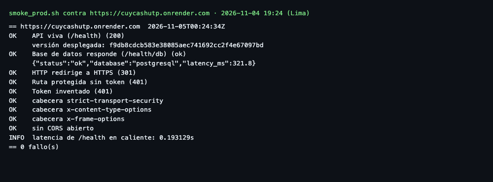
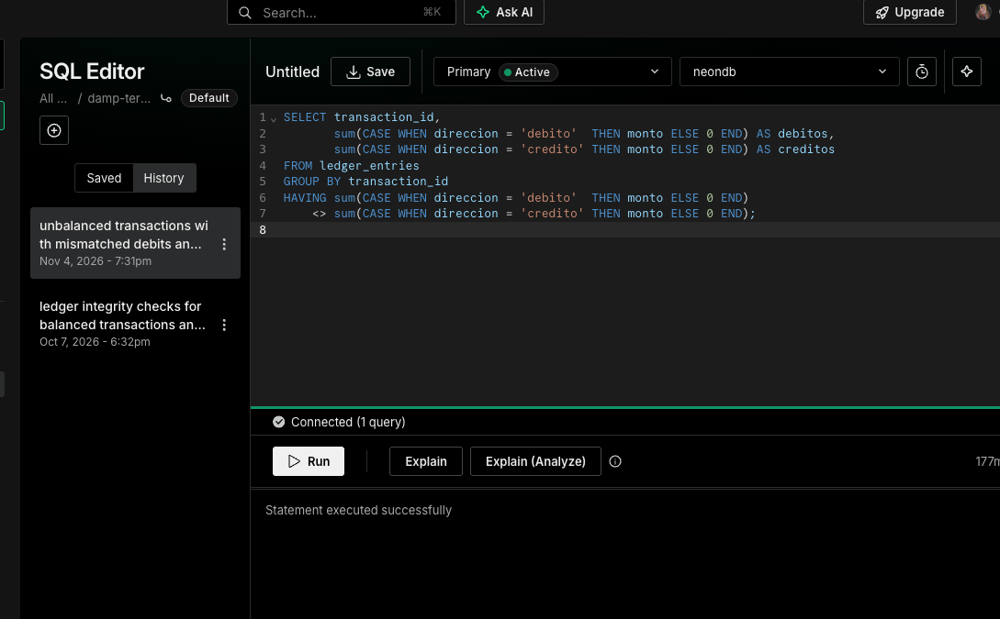

# E. Validación en la plataforma Cloud

**Responsable:** Andersson Espinoza (#102, #127) · **URL:** <https://cuycashutp.onrender.com>
· **Plataforma:** Render + Neon (PostgreSQL) · **Corte:** 04/11/2026 19:24 (Lima).

## E.1 Versión desplegada

`GET /health` devuelve `f9db8cdcb583e38085aec741692cc2f4e67097bd`. La v2 se publica
solo por GitHub Actions (`cd-backend.yml`), con aprobación en el environment
`production`; el 03/11 producción aún corría `d74d663` (v1). Al 05/11 `/health` devuelve
`7e3d3ea`, que incluye el PR #132. La tabla siguiente corresponde a la corrida del 04/11;
el humo repetido sobre `7e3d3ea` también dio 0 fallos (`smoke-prod-7e3d3ea.txt`).

## E.2 Pruebas automatizadas contra producción

| Verificación | Esperado | Obtenido | Fecha |
|---|---|---|---|
| `/health` | HTTP 200 y commit | ✅ 200, `f9db8cd` | 04/11 |
| `/health/db` | PostgreSQL disponible | ✅ `ok`, 321.8 ms | 04/11 |
| HTTP → HTTPS | 301 | ✅ 301 | 04/11 |
| Ruta protegida sin token | 401 | ✅ 401 | 04/11 |
| Token inventado | 401 | ✅ 401 | 04/11 |
| HSTS, `nosniff`, `X-Frame-Options` | Presentes | ✅ Presentes | 04/11 |
| CORS | Sin abrir | ✅ Sin abrir | 04/11 |
| DNI de 7 dígitos | 422 | ✅ 422 | 03/11 (v1) |

Cumplimiento del humo: **0 fallos**. Latencia de `/health` en caliente: 193 ms,
muestra puntual con red. No equivale a un p95 ni al SLA del motor transaccional.
El primer `/health` del 04/11 tardó 21 s: el plan gratuito de Render tiene arranque
en frío, y por eso el servicio se precalienta antes de la demostración.

## E.3 UAT funcional

| Escenario | Entorno | Resultado |
|---|---|---|
| UAT-2: rechazo sin saldo | Docker + PostgreSQL 16 local | ✅ Dos intentos rechazados; saldos intactos |
| UAT-1: envío de S/ 125.50 | Docker + PostgreSQL 16 local | ✅ Saldos finales 37450/12550; reintento idempotente |
| Cuadre del libro mayor | PostgreSQL local | ✅ Cero transacciones y cuentas descuadradas |
| UAT-1 y UAT-2 contra Render | Producción | ⏳ No completado: el alta ficticia del 03/11 sobre la v1 recibió `403 KYC_REQUIRED` |
| Cuadre de débitos y créditos en Neon | Producción | ✅ La consulta de descuadres no devolvió filas (04/11, 19:31) |
| Recorrido APK → nube | Producción | 🟡 El equipo reporta un depósito entre cuentas desde la v0.3.0 (05/11); falta adjuntar captura y su fila en Neon |

El rechazo del alta es correcto: el control de KYC no se desactivó para el ensayo.
`scripts/uat_prod.py` exige `--allow-writes` y `--production-approved`, nunca imprime
PIN ni tokens y usa solo identificadores sintéticos. La evidencia local no sustituye
a la validación en la nube. El detalle está en `docs/apf3/evidencias/andersson/`.

La consulta de integridad de `services/api/scripts/monitoreo.sql` lista toda transacción
cuyos débitos difieran de sus créditos; se ejecutó en el SQL Editor de Neon:

## E.4 Observaciones

1. La validación de lectura y seguridad de borde está completa sobre la v2.
2. La validación funcional con escritura en la nube está programada con cuentas que
   superen el KYC real, sin desactivar controles (Anexos).
3. El PR #132 ya corre en producción y el humo se repitió. El paso a PostgreSQL 18 está en
   `main`, pero su despliegue espera aprobación.

## E.5 Distribución del APK de la v2

El workflow `build-apk.yml` compila el APK de producción al crear un tag `v*`. Lo firma
con una clave propia guardada en GitHub Secrets, usa el número de corrida como
`versionCode` y lo publica en GitHub Releases y en Firebase App Distribution, sin
pasar por una tienda pública. Antes se firmaba con la clave de depuración, distinta
en cada runner, por lo que un APK nuevo no actualizaba al instalado.

| Verificación | Resultado | Fecha |
|---|---|---|
| Cambios integrados en `main` (PR #136) | ✅ Integrado | 05/11 |
| Compilación local con clave temporal | ✅ `apksigner` confirma la firma; `versionCode` 4 | 05/11 |
| Secretos de firma y de Firebase | ✅ 6 cargados | 05/11 |
| Primera corrida automática, tag `v0.3.0` | ❌ Falló al firmar: `keystore password was incorrect`. No se publicó el Release ni se envió a Firebase | 05/11 |
| Segunda corrida, tras corregir el secreto | ✅ Build, Release y Firebase en verde | 05/11 |
| Firma del APK publicado | ✅ `apksigner` muestra `CN=Jair` y no la clave de depuración; `versionCode` 4 | 05/11 |
| Envío a Firebase App Distribution | ✅ Release 0.1.0 (4) distribuido a los testers y grupos | 05/11 |
| Instalación en un teléfono | ✅ Reportada por el equipo, con una operación probada | 05/11 |

La primera falla no fue del workflow: la contraseña guardada en los secretos no abría
la clave. Corregido el secreto, la misma corrida pasó en su segundo intento:
<https://github.com/Los-hijos-de-Rene/CuyCashUTP/actions/runs/42086158351>.
Release: <https://github.com/Los-hijos-de-Rene/CuyCashUTP/releases/tag/v0.3.0>.
